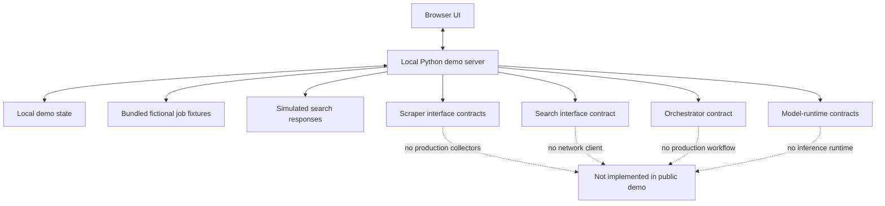

<div align="center">

# ✨ Personal Job Finder Demo
### Public Demo

**A polished, local-first preview of a modular job-search workspace featuring a multi-page UI, candidate profiles, job tracking, and simulated search and AI integrations.**

Explore the interface, try the workflow, track fictional vacancies, and see how the application is organized—without exposing production scrapers, private orchestration logic, model files, or personal job-search data.

<p>
  
  
  
  
</p>

> [!IMPORTANT]
> **This is a demonstration—not the production job-finding system.** Vacancies, companies, scores, source statuses, and model entries are fictional. Search, scraping, AI analysis, CV processing, model discovery, and runtime activation are simulated. The demo makes no outgoing Internet requests.

</div>

---

## 🧭 At a glance

| | What you can do |
|---|---|
| 🖥️ **Explore** | Navigate a multi-page job-search interface with a cohesive dashboard and settings pages. |
| 🔎 **Preview discovery** | Run a simulated search and inspect fictional job cards. |
| 📌 **Track** | Save demo vacancies, update application statuses, filter records, and export sample data to CSV. |
| 👤 **Personalize** | Edit a fictional candidate profile and local demo preferences. No CV upload or parsing is performed. |
| 🧩 **Inspect the architecture** | Explore separate interface contracts for scrapers, search, orchestration, and model runtimes. |
| 🛡️ **Run locally** | Use a Python-standard-library application bound to loopback, with no live integrations configured. |

## 🚀 Quick start

### Requirements

- **Python 3.11 or newer**
- Windows, macOS, or Linux
- No `pip install` step is required; the demo uses Python's standard library
- Node.js is optional and only needed for the JavaScript syntax check

### Windows

1. Download or clone this repository and extract it if necessary.
2. Double-click **`start_windows.bat`**.
3. Open **[http://127.0.0.1:7860/](http://127.0.0.1:7860/)** in your browser.
4. Use the fictional demo data. To stop the server, press **Ctrl+C** in the terminal.

If port `7860` is already in use, choose another port in Command Prompt before launching:

```bat
set JOB_FINDER_PORT=7861
py -3 main.py
```

Then visit `http://127.0.0.1:7861/`.

### macOS / Linux

From the repository directory:

```bash
chmod +x start_mac_linux.sh
./start_mac_linux.sh
```

Open [http://127.0.0.1:7860/](http://127.0.0.1:7860/) and stop the server with **Ctrl+C**.

Alternatively, launch it directly:

```bash
JOB_FINDER_PORT=7861 python3 main.py
```

### Run the tests

```bash
python -m unittest discover -s tests -v
python -m compileall -q main.py demo_services scrapers search orchestrator model_runtime tests
```

If Node.js is available:

```bash
node --check static/app.js
```

The repository also includes a GitHub Actions workflow that runs the automated test suite on pushes and pull requests.

---

## 🗺️ Explore the workspace

The demo contains seven main pages:

| Page | Purpose |
|---|---|
| **Overview** | See the sample workspace and high-level job-tracker stats. |
| **Search Demo** | Trigger a fixture-backed search preview. This does not contact a search engine. |
| **Job Tracker** | Filter fictional jobs, change their statuses, remove records from the demo tracker, and export CSV. |
| **CV & Profile** | Edit a sample candidate profile. CV upload and extraction are intentionally unavailable. |
| **Model Manager** | Preview fictional model cards and activation states. No local files are scanned or models loaded. |
| **Source Health** | Preview source/service status cards. No scraper or external service is contacted. |
| **Settings** | Edit local demo preferences and reset the demo settings. These do not configure a production backend. |

### What is functional—and what is simulated?

| Capability | Demo status | Details |
|---|---|---|
| Page rendering and navigation | ✅ Implemented | Pages, shared styling, and client-side interactions work locally. |
| Demo profile and preferences | ✅ Implemented | Fictional values can be edited and saved to local demo state. |
| Sample job tracking | ✅ Implemented | Save records, update statuses, filter results, and remove sample records. |
| CSV export | ✅ Implemented | Exports fictional tracker records; spreadsheet-formula safety is applied. |
| Search results | 🎭 Simulated | Returned from bundled fixtures, not the Internet. |
| Scraper collection | 🎭 Simulated | No real source adapters are included. |
| SearXNG integration | 🚫 Not included | No SearXNG client or live search endpoint is present. |
| Orchestrator / AI analysis | 🚫 Not included | Contracts show intended boundaries; no production workflow, prompts, or model calls run. |
| CV upload and analysis | 🚫 Not included | The demo does not upload or parse a CV. |
| Model scanning and activation | 🎭 Simulated | No model files, GPU status, or runtime are inspected or activated. |

All example vacancies use reserved **`.invalid` URLs**. They are intentionally non-clickable as real application destinations. A simulated “success” means only that the demo interaction ran; it does not indicate a real source, model, or service is healthy.

---

## 🧱 Architecture at a glance

The public demo keeps the visible product and the intended module boundaries while omitting the production implementations.



### Repository layout

```text
PersonalJobFinder-Public-Demo/
├── main.py                    # Local demo HTTP server and demo routes
├── templates/                 # Multi-page HTML templates
├── static/                    # Shared CSS and JavaScript
├── demo_fixtures/             # Fictional jobs only
├── demo_services/             # Sample search and model responses
├── scrapers/                  # Abstract collector contracts only
├── search/                    # Abstract search contract only
├── orchestrator/              # Abstract orchestration contract only
├── model_runtime/              # Abstract runtime/inference contracts only
├── config/                    # Sanitized example configuration
├── data/                      # Ignored local demo state
├── tests/                     # Automated regression and safety tests
├── .github/workflows/         # CI test workflow
├── start_windows.bat
├── start_mac_linux.sh
├── PUBLIC_DEMO_SCOPE.md       # Explicit scope and omission list
└── LICENSE_NOT_SELECTED.md    # License decision reminder
```

The interface contracts deliberately raise `NotImplementedError` where a production implementation would be required. This is intentional: the public demo must not be mistaken for the real scraper or orchestrator stack.

---

## 🔐 Privacy and safety by design

- **Loopback-only:** the server binds to `127.0.0.1`; it is not designed for public hosting or access from other devices.
- **No outbound network calls:** search, source checks, model checks, and analysis are simulated locally.
- **Fictional records:** bundled jobs and company names are made-up examples; URLs use `.invalid`.
- **Local state is ignored by Git:** edits are written to `data/demo_state.json`, which is excluded from version control.
- **No CV upload:** do not enter real personal or sensitive information into a public demonstration.
- **No secrets or model weights:** none are needed for this demo.

For the full list of included, simulated, and deliberately omitted capabilities, see [`PUBLIC_DEMO_SCOPE.md`](PUBLIC_DEMO_SCOPE.md).

## 🧑‍💻 Contribution and project boundaries

Issues and suggestions about the **public demo**—its usability, accessibility, documentation, tests, and interface organization—can be discussed in this repository.

The production job finder is maintained separately. Do not submit private candidate data, job history, credentials, model weights, or proprietary production scraper/orchestrator implementations to this repository. Public source code can be copied; frontend hiding, minification, or feature flags do not make shipped code private.

## Copyright and Usage

Copyright © 2026 Daniel Tanasescu (@DanielTanasescu9). All rights reserved.

This repository is a public demonstration of Personal Job Finder. Unless otherwise stated, no license is granted to copy, modify, distribute, or use this project's code, except as permitted by applicable law and GitHub's Terms of Service.

The production application, private scraper implementations, and proprietary orchestration logic are maintained separately.

GitHub profile: https://github.com/DanielTanasescu9

---

## 📄 License

**No license has been selected yet.** Before inviting others to reuse, modify, or redistribute the code, choose a license that reflects the permissions you want to grant. Until then, do not assume that others have permission to reuse it. See [`LICENSE_NOT_SELECTED.md`](LICENSE_NOT_SELECTED.md).

---

<div align="center">

**Personal Job Finder · Public Demo**  
*A transparent preview of the product architecture—fictional data, local interactions, no hidden live integrations.*

---

</div>

